# Zephyr baseline port

## Implementation

Ported the existing [`FieldEdge-Evapotranspiration`](https://github.com/cloclacordis/FieldEdge-Evapotranspiration) bare-metal STM32 application to Zephyr RTOS 4.5.0 on the Nucleo-F446RE board (STM32F446RET6 MCU).

The existing EvapoCore computation pipeline was preserved. Platform-specific services were migrated to Zephyr, including:

- RTC and backup trust state;  
- UART service console and UTC time setting;  
- GPIO status LED;  
- execution-time measurement.

Sensor inputs remain emulated. No changes were made to the FAO-56 calculation model.

## Verification

- Host build and regression tests passed under C17.  
- AddressSanitizer and UndefinedBehaviorSanitizer checks passed.  
- Zephyr firmware built successfully for `nucleo_f446re`.  
- Hardware operation verified on the STM32F446RE (Nucleo board).  
- RTC initialization, UTC setting, trust validation and reset behavior checked.  
- UART commands `TIME`, `SET-UTC` and `RUN` verified.  
- Daily calculation, status reporting and execution-time measurement verified.

### Verification details

#### Host build and regression tests

```bash
cmake -S evapocore -B build
cmake --build build
ctest --test-dir build --output-on-failure
```

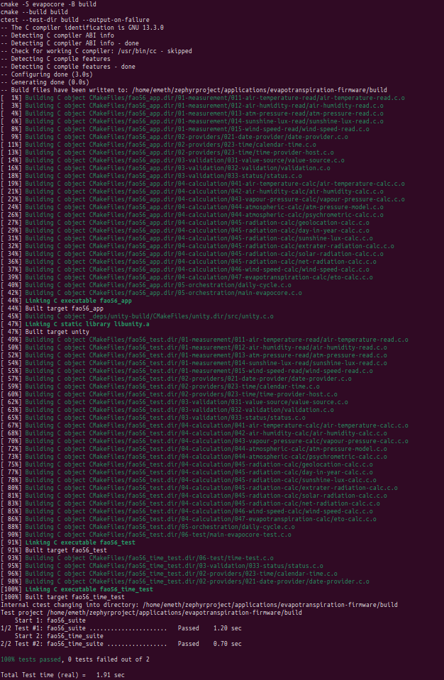

```bash
cmake -S evapocore -B build-sanitize -DENABLE_SANITIZERS=ON
cmake --build build-sanitize --target fao56_test
ctest --test-dir build-sanitize -R '^fao56_suite$' --output-on-failure
```

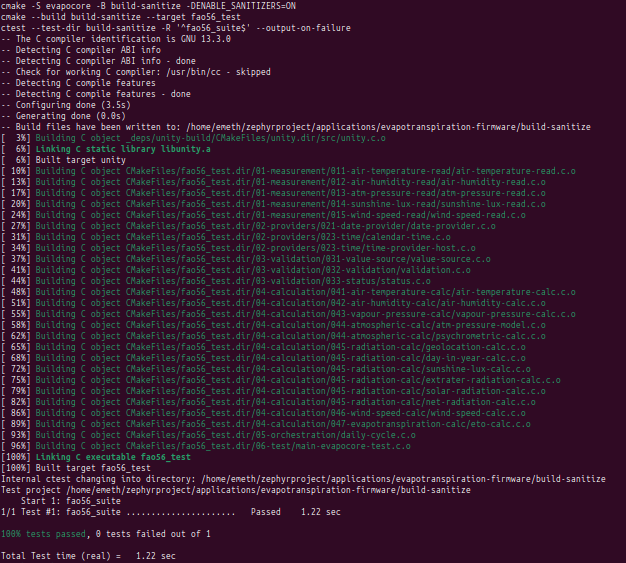

#### Zephyr firmware build

```bash
source ~/zephyrproject/.venv/bin/activate
cd ~/zephyrproject/applications/evapotranspiration-firmware
west build -p always -b nucleo_f446re -d build-zephyr .
```

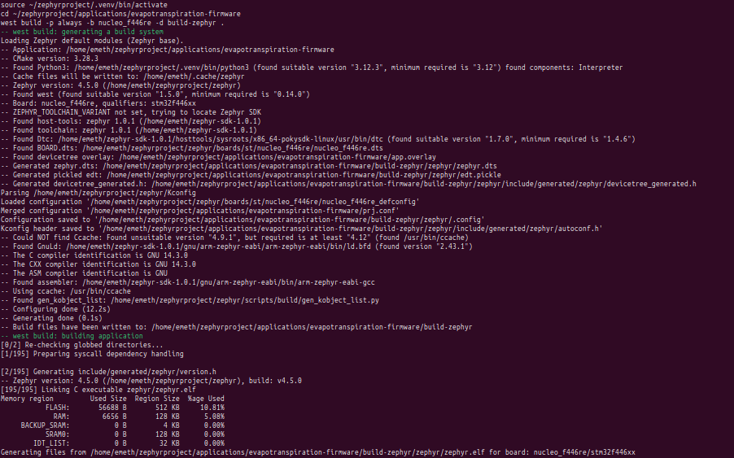

```bash
grep -E '^CONFIG_(RTC|BBRAM|GPIO|UART_CONSOLE|STDOUT_CONSOLE|UART_INTERRUPT_DRIVEN|PICOLIBC_IO_FLOAT|STM32_ENABLE_DEBUG_SLEEP_STOP|MAIN_STACK_SIZE)=' \
    build-zephyr/zephyr/.config
```

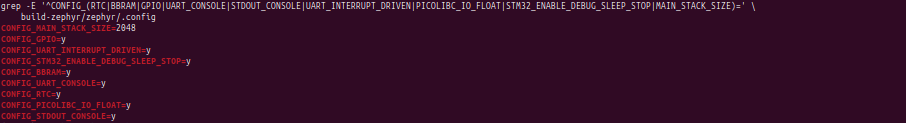

#### Flashing and UART console

```bash
west flash -d build-zephyr --runner openocd
```

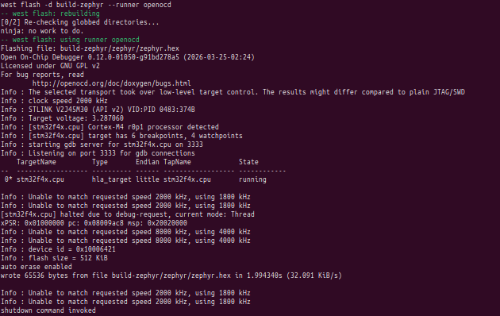

```bash
minicom -D /dev/ttyACM0 -b 115200
```

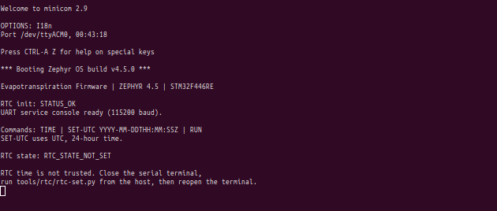

#### RTC commissioning and command handling

On the initial boot, the RTC was not trusted. Checked time reporting, invalid command handling, invalid date rejection, and prevention of `RUN` while the RTC was untrusted.

```text
TIME
FOO
SET-UTC 2026-02-30T12:00:00Z
RUN
```

**Note:** The console does not echo typed input; commands must be entered without visual feedback.

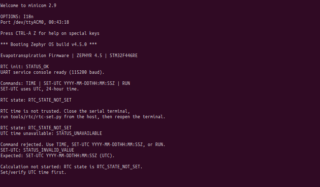

Closed Minicom to release the serial port and set UTC using the host.

```bash
python3 tools/rtc/rtc-set.py --port /dev/ttyACM0
```

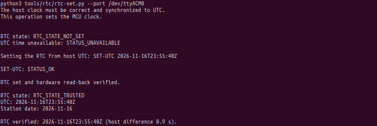

The utility sent the `SET-UTC` command and verified the RTC read-back. Reopened Minicom and checked the trusted time:

```text
TIME
```

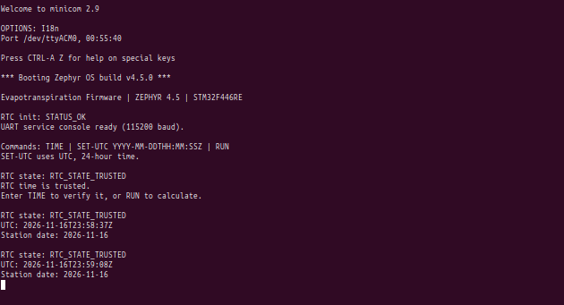

#### RTC retention across system reset

With USB power maintained, reset the board and checked the RTC again:

```text
TIME
```

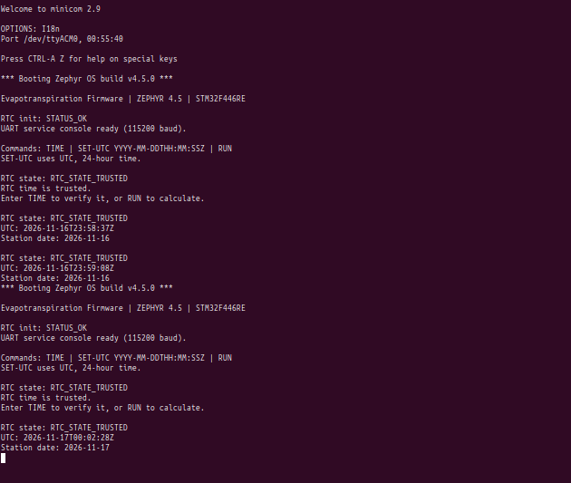

The trusted state was retained, and the UTC timestamp continued advancing.

After complete USB power removal, the backup state was lost as expected because no independent VBAT supply was connected. UTC time had to be commissioned again.

#### Daily calculation

With the RTC in the trusted state, started the daily calculation:

```text
RUN
```

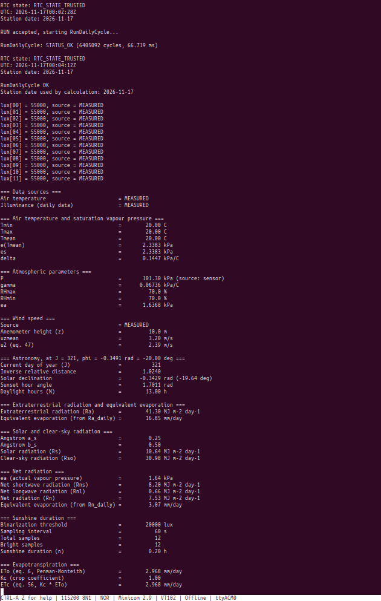

The cycle completed successfully. The status LED indicated execution, and the firmware printed the calculation trace, execution time, and final FAO-56 report, including ETo and ETc.

**Note:** The report uses emulated sensor inputs; the `MEASURED` labels reflect the current mock-provider configuration.

## Result

The Zephyr baseline port is complete.
